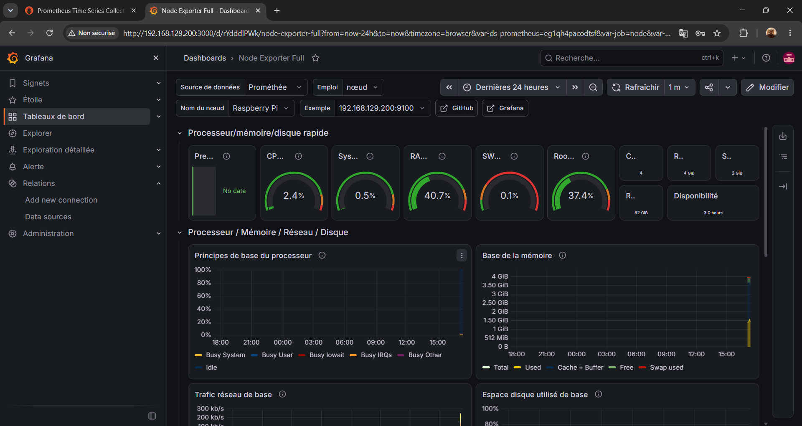
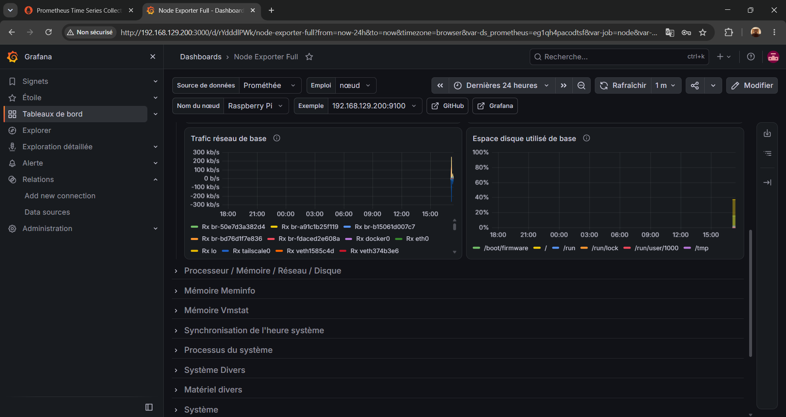
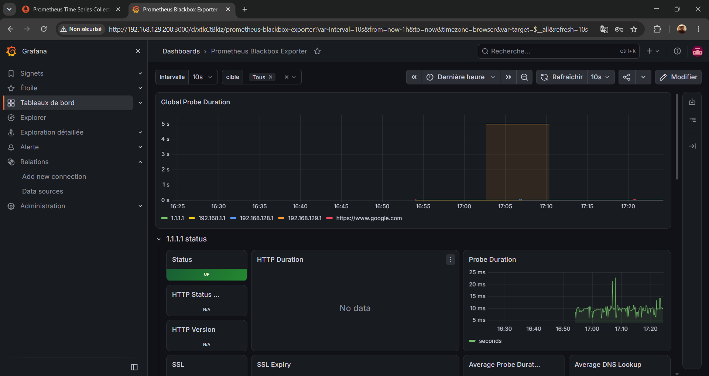
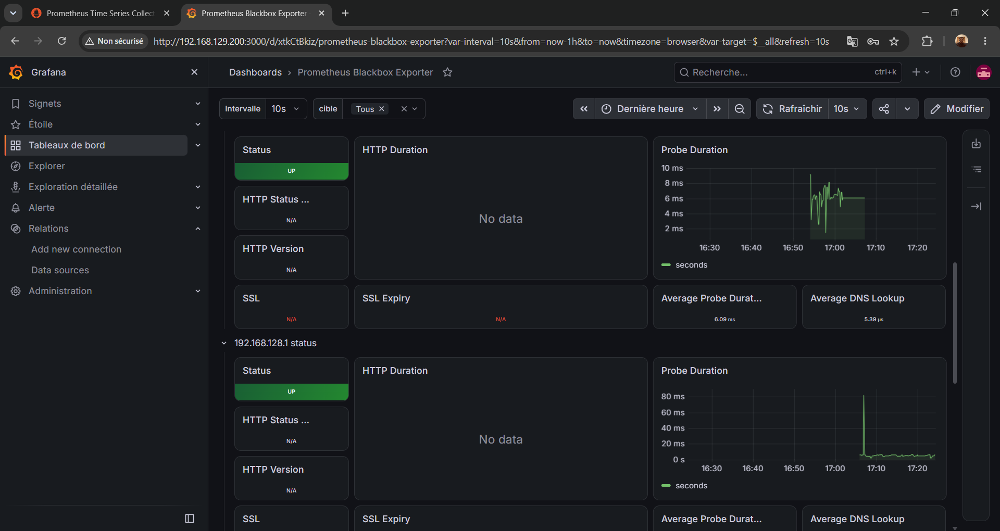
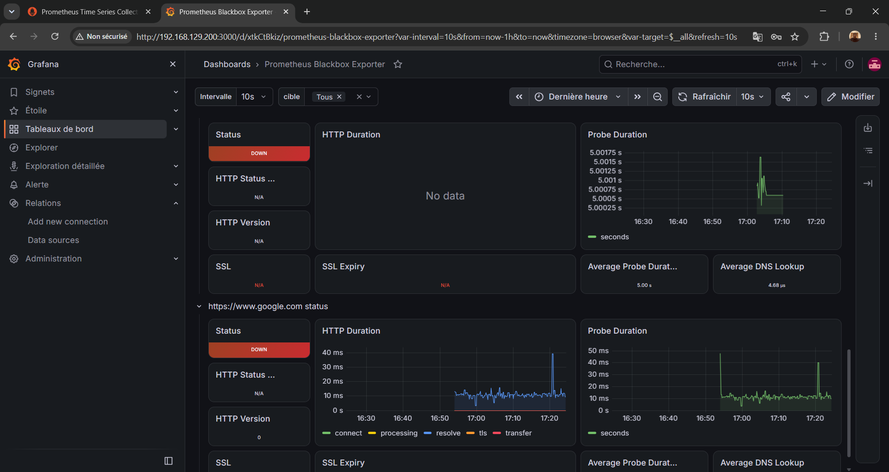
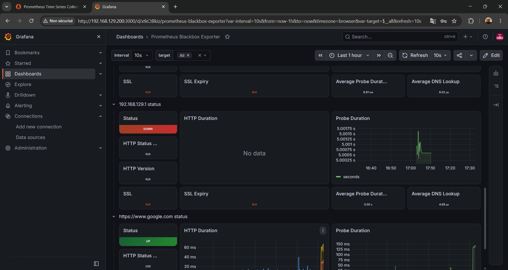
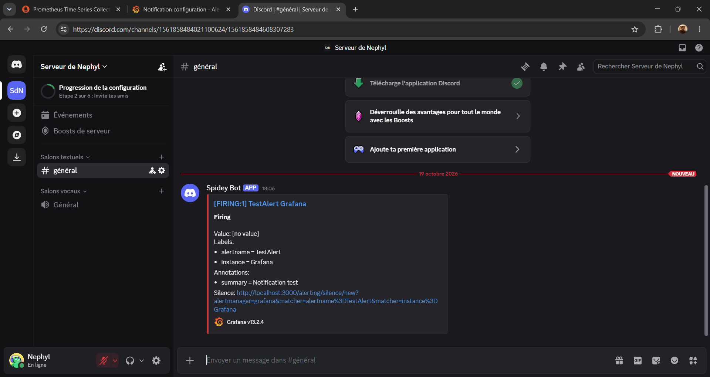
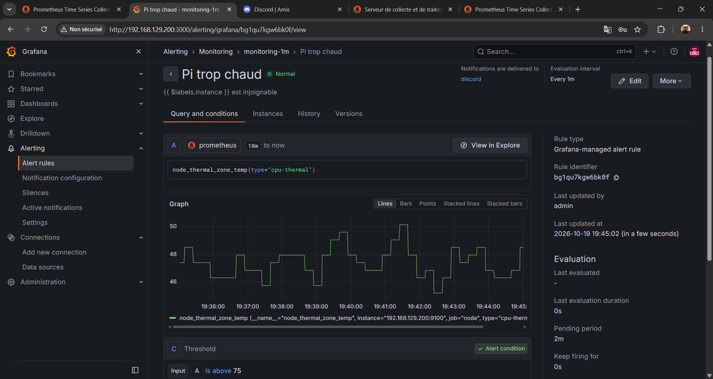
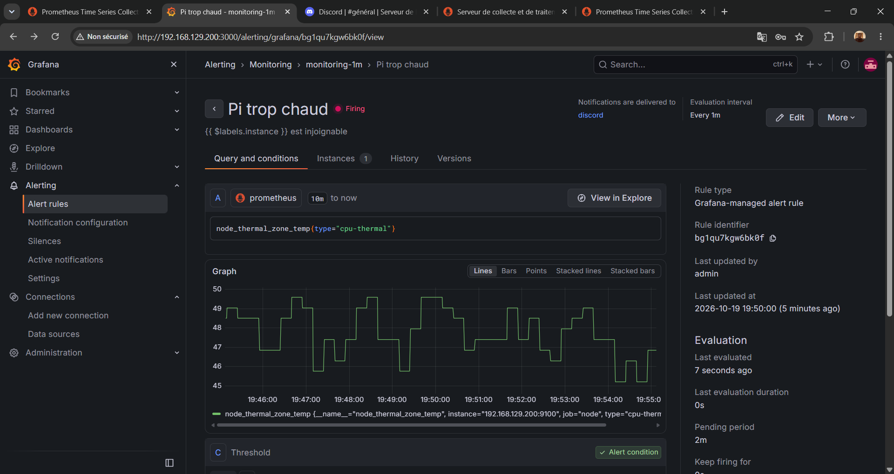
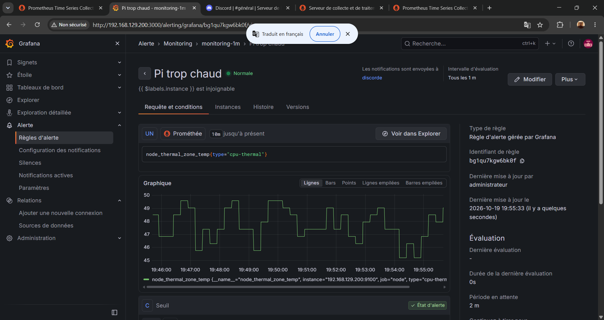

# Monitoring réseau avec Prometheus et Grafana sur Raspberry Pi

Supervision d'un petit réseau domestique et d'un Raspberry Pi 5 avec une stack Docker Compose : collecte des métriques, tableaux de bord Grafana et alertes envoyées sur Discord.

## Objectifs du projet

- Surveiller l'état du Raspberry Pi : CPU, RAM, disque, température, trafic réseau.
- Vérifier en continu la disponibilité de la box, d'Internet (1.1.1.1) et d'un site web (HTTP).
- Être prévenu automatiquement sur Discord en cas de panne ou de surchauffe.
- Apprendre les outils de supervision utilisés en entreprise (Prometheus, Grafana, exporters).

## Architecture

```
Raspberry Pi 5 (Docker Compose)
├── Node Exporter       → métriques système du Pi (CPU, RAM, disque, température, réseau)
├── Blackbox Exporter   → sondes ICMP (ping) et HTTP
├── Prometheus          → collecte (toutes les 15 s) et stockage (rétention 30 jours)
└── Grafana             → dashboards + règles d'alerte → Discord (webhook)
```

Fonctionnement : Prometheus interroge Node Exporter et Blackbox Exporter à intervalle régulier et stocke les mesures. Grafana lit ces données pour les afficher, évalue les règles d'alerte chaque minute et envoie une notification sur Discord quand une condition est remplie.

## Composants

| Service | Rôle | Port |
|---|---|---|
| Prometheus | Collecte et stocke les métriques | 9090 |
| Grafana | Dashboards et alertes | 3000 |
| Node Exporter | Métriques du Pi (mode réseau `host`) | 9100 |
| Blackbox Exporter | Tests de disponibilité (ping, HTTP) | 9115 (interne) |

## Prérequis

- Un Raspberry Pi (testé sur un Pi 5, Raspberry Pi OS 64 bits) ou toute machine Linux
- Docker et Docker Compose installés
- Les ports 3000 et 9090 libres
- Un serveur Discord (gratuit) pour recevoir les alertes

## Structure du dépôt

```
.
├── docker-compose.yml        # Les 4 services de la stack
├── prometheus/
│   └── prometheus.yml        # Cibles et fréquence de collecte
├── blackbox/
│   └── blackbox.yml          # Modules de sonde ICMP et HTTP (IPv4 forcé)
└── docs/
    └── screenshots/          # Captures des dashboards et des alertes
```

## Installation

1. Cloner le dépôt sur le Raspberry Pi :
```bash
   git clone https://github.com/Tekawejulio/grafana-prometheus-raspberry-pi.git
   cd grafana-prometheus-raspberry-pi
```
2. Adapter dans `prometheus/prometheus.yml` l'IP du Pi (job `node`) et l'IP de la box (job `blackbox_icmp`).
3. Lancer la stack :
```bash
   docker compose up -d
   docker compose ps
```
4. Ouvrir Grafana sur `http://IP_DU_PI:3000` (identifiants par défaut `admin` / `admin`, à changer immédiatement).
5. Ajouter la source de données : *Connections > Data sources > Prometheus*, URL `http://prometheus:9090`, puis *Save & test*.
6. Importer les dashboards : *Dashboards > New > Import*, ID **1860** (Node Exporter Full) puis ID **7587** (Prometheus Blackbox Exporter).

## Fichiers de configuration

### docker-compose.yml

Quatre services : Prometheus (avec volume persistant et rétention de 30 jours), Node Exporter (en mode réseau `host` pour lire les vraies interfaces du Pi), Blackbox Exporter (avec la capacité `NET_RAW` pour envoyer des pings) et Grafana (avec volume persistant).

### prometheus/prometheus.yml

Quatre jobs de collecte :

| Job | Cible | Rôle |
|---|---|---|
| `prometheus` | `prometheus:9090` | Auto-supervision |
| `node` | `IP_DU_PI:9100` | Métriques système du Pi |
| `blackbox_icmp` | `1.1.1.1`, `IP_DE_LA_BOX` | Ping vers Internet et la box |
| `blackbox_http` | `https://www.google.com` | Test HTTP (code 2xx) |

### blackbox/blackbox.yml

Deux modules (`http_2xx` et `icmp`) avec `preferred_ip_protocol: ip4` : voir « Problèmes rencontrés » ci-dessous.

## Alertes

Les alertes sont gérées par Grafana et envoyées sur Discord via un webhook (*contact point*).

### Configurer le canal Discord

1. Sur Discord, créer un serveur, puis dans un salon : *Modifier le salon > Intégrations > Webhooks > Nouveau webhook > Copier l'URL*.
2. Dans Grafana : *Alerting > Contact points > Add contact point*, intégration **Discord**, coller l'URL, puis **Test** et **Save**.

### Règles créées

| Règle | Requête PromQL | Condition | Durée avant alerte |
|---|---|---|---|
| Cible injoignable | `probe_success` | inférieur à 1 | 2 min |
| Pi trop chaud | `node_thermal_zone_temp{type="cpu-thermal"}` | supérieur à 75 | 2 min |

Les règles sont dans le dossier `Monitoring`, groupe d'évaluation `monitoring-1m` (intervalle d'une minute), et notifient le contact point `discord`. Elles envoient un message **[FIRING]** à la panne et **[RESOLVED]** au retour à la normale.

### Tester une alerte

Ajouter temporairement une fausse cible (par exemple `10.255.255.1`) dans le job `blackbox_icmp`, redémarrer Prometheus (`docker compose restart prometheus`) et attendre environ 3 à 4 minutes : le message d'alerte arrive sur Discord. Retirer ensuite la fausse cible pour recevoir le message de retour à la normale.

## Vérifier que tout fonctionne

- `docker compose ps` : les 4 conteneurs sont `Up`.
- `http://IP_DU_PI:9090/targets` : toutes les cibles sont `UP`.
- Dans Prometheus, la requête `probe_success` vaut `1` pour chaque cible sondée (`0` = en panne).
- Dans Grafana, les dashboards affichent des données, et le bouton *Test* du contact point envoie un message sur Discord.

## Captures d'écran

### Dashboard Node Exporter (état du Raspberry Pi)




### Dashboard Blackbox (disponibilité des cibles)




### Diagnostic du problème IPv6 (avant et après)




### Alertes Discord






## Problèmes rencontrés et solutions

- **Sonde HTTP en échec vers google.com** : Blackbox préférait l'IPv6, alors que le réseau Docker n'en dispose pas. Diagnostic avec l'endpoint `/probe?...&debug=true` de Blackbox. Solution : forcer `preferred_ip_protocol: ip4` dans `blackbox/blackbox.yml`.
- **Cible Prometheus « UP » mais sonde en échec** : « UP » signifie seulement que Prometheus arrive à lire Blackbox, pas que la sonde a réussi. Il faut surveiller la métrique `probe_success`.
- **Alerte qui ne se déclenchait jamais** : la condition était réglée sur « supérieur à 1 », alors que `probe_success` vaut 0 ou 1. Corrigée en « inférieur à 1 ».
- **Cible `node` injoignable via `host.docker.internal`** : remplacée par l'IP du Pi, plus fiable avec Node Exporter en mode réseau `host`.
- **Sondes d'anciennes adresses encore affichées** : après un changement de cible, les anciennes séries restent visibles dans les dashboards jusqu'à la fin de la fenêtre de temps.

## Sécurité

- Le mot de passe admin de Grafana est modifié dès la première connexion.
- Le webhook Discord est enregistré dans Grafana : il n'est jamais écrit dans les fichiers du dépôt.
- Prometheus (port 9090) n'a pas d'authentification : à n'exposer que sur le réseau local, ou à placer derrière un VPN (WireGuard) ou un reverse proxy.

## Compétences mises en pratique

- Conteneurisation avec Docker et Docker Compose
- Supervision : Prometheus, Grafana, exporters, PromQL
- Réseau : ICMP, HTTP, IPv4 / IPv6, adressage, diagnostic de pannes
- Administration Linux sur Raspberry Pi (SSH, logs, gestion de services)
- Alerting et notifications (webhook Discord)

## Pistes d'amélioration

- Ajouter SNMP Exporter pour superviser un switch ou un routeur.
- Ajouter cAdvisor pour les métriques des conteneurs Docker.
- Passer à Alertmanager pour un routage plus fin des alertes.
- Accéder aux dashboards uniquement via VPN (WireGuard) ou un reverse proxy.

## Auteur

Julio, étudiant en informatique (réseaux et systèmes).  
GitHub : [Tekawejulio](https://github.com/Tekawejulio)
